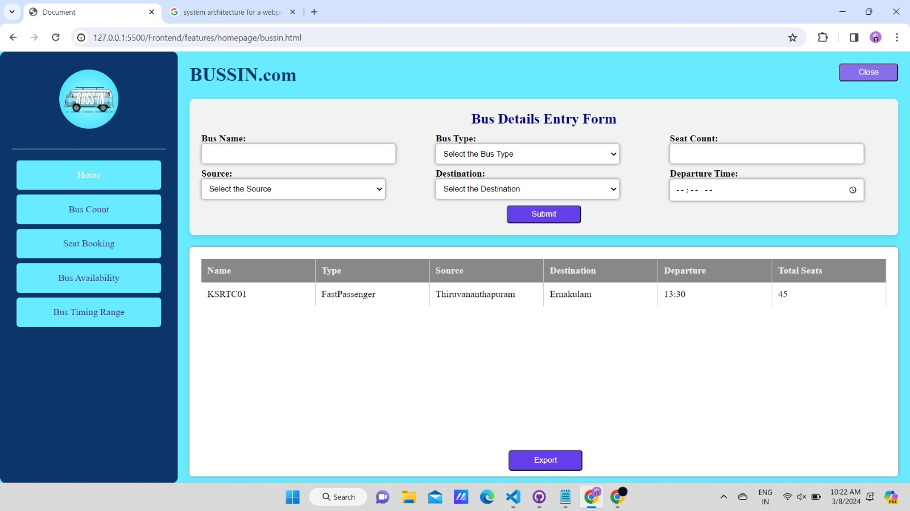

<div align="center">

# 🚌 Bussin

**A bus schedule and seat-booking manager for Kerala routes — Java backend, vanilla JS frontend.**




</div>

## Overview

Bussin manages bus details — name, type, source, destination, departure time and available seats — and lets you slice that schedule the way a commuter actually asks questions: *"what leaves Thiruvananthapuram for Kollam this evening?"*

The project has two halves that share the same CSV data:

- **Backend (Java)** — a console application that reads bus data from CSV, filters it and writes the results back out as CSV.
- **Frontend (HTML/CSS/JS)** — a browser UI for entering buses, browsing the filtered schedules, counting buses by type and booking seats.

A full write-up is in [`BUSSIN.com Project Documentation.pdf`](BUSSIN.com%20Project%20Documentation.pdf).

## Features

| Feature | What it does |
|---|---|
| **Add buses** | Enter bus details through a form; they appear in a table on the homepage. |
| **Export** | Download the entered buses as a JSON file. |
| **Source / destination filter** | Filter by source, destination, or both. |
| **Time-range filter** | Morning (08–12), afternoon (12–16), evening (16–20) and night (20–08) slots. |
| **Bus type counts** | See how many buses of each type are running. |
| **Seat booking** | Reserve or release seats on a given bus. |

## Project structure

```
Backend/busin/src/        Java console app — Main, Bus, Reservation, filters, CSV reader/writer
Frontend/
  common/                 shared form/table components, alert box, styles
  features/
    homepage/             add buses + JSON export
    sourcedestinationfilter/
    bustiming/            time-range views
    buscount/             counts by bus type
    seatbooking/          reserve / release seats
CommonFiles/              sample and generated CSV data
```

## Getting started

**Backend**

```bash
cd Backend/busin/src
javac *.java
java Main
```

Pick an option from the menu (filter by source/destination, by time range, by bus type, or make a reservation). Output CSVs are written alongside the inputs.

**Frontend**

Open `Frontend/features/homepage/bussin.html` in a browser — or serve the folder with any static server (e.g. VS Code Live Server) so the JSON files load correctly.

## Tech stack

Java (core, file I/O) · HTML5 · CSS3 · JavaScript

## Author

**Muhammed Safar** — [@safar-byte](https://github.com/safar-byte)
